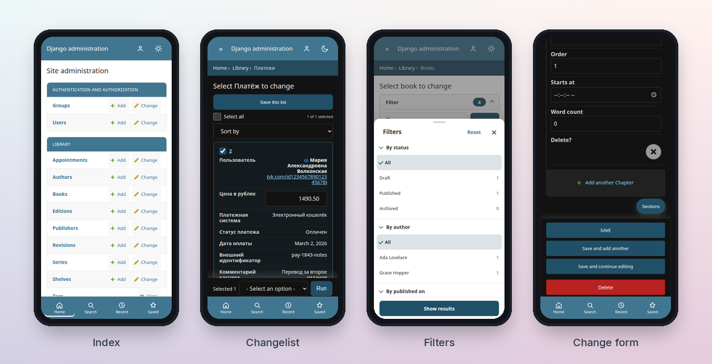
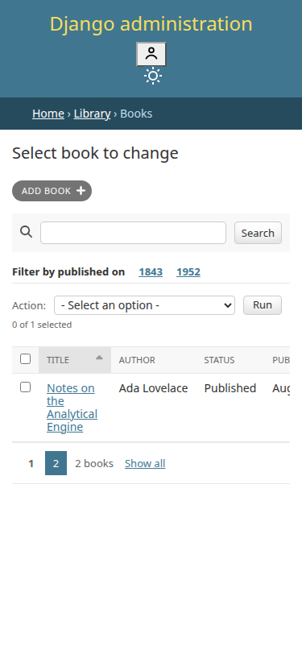
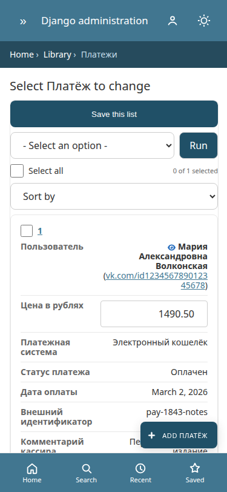
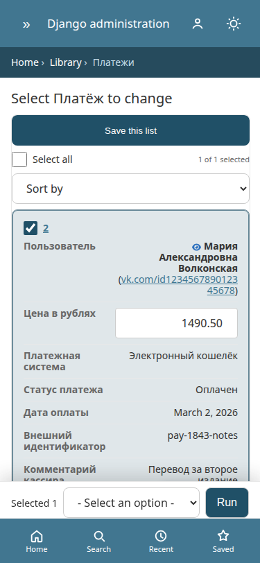
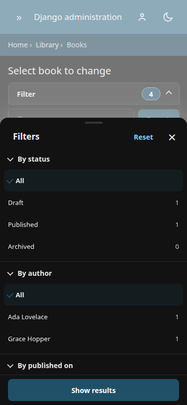
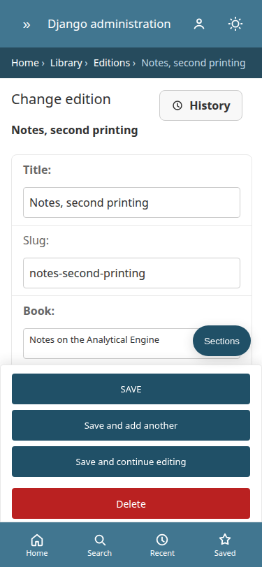
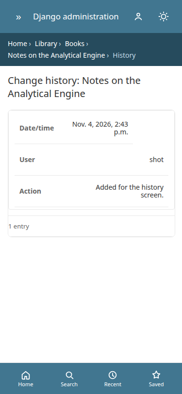
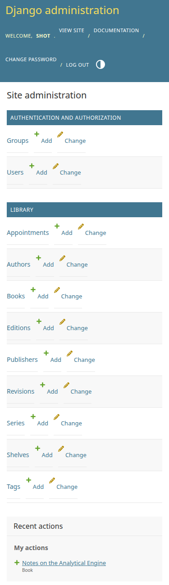
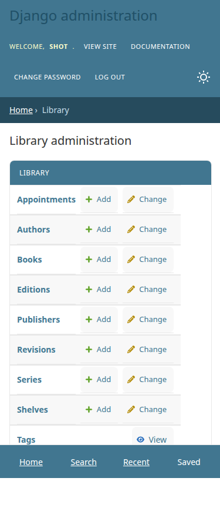
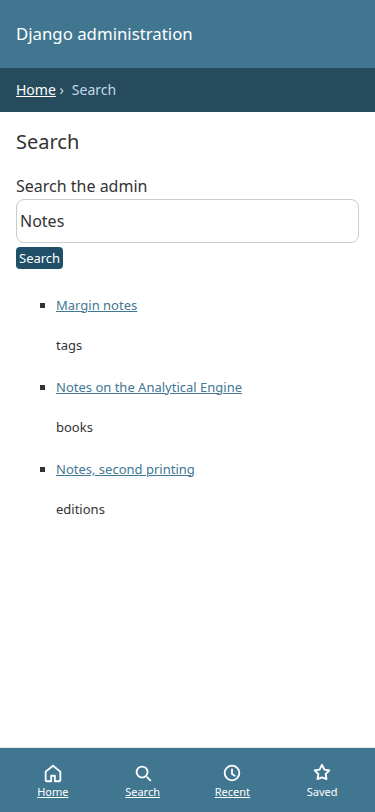

# django-admin-mobile

Phone ergonomics for the native Django admin. Same colors, same templates, a layout that fits a 375px screen.

[](https://pypi.org/project/django-admin-mobile/)
[](https://pypi.org/project/django-admin-mobile/)
[](https://docs.djangoproject.com/)
[](LICENSE)
[](https://github.com/daniilshamraev/django-admin-mobile/actions/workflows/ci.yml)



## Before / after

Stock Django admin at 375px, then the same changelist with this package.

| Before | After |
| --- | --- |
| <picture><source media="(prefers-color-scheme: dark)" srcset="docs/screenshots/stock-changelist-375-dark.png"></picture> | <picture><source media="(prefers-color-scheme: dark)" srcset="docs/screenshots/changelist-375-dark.png"></picture> |

## Changelist

Cards, a full-width action row, and a sticky bulk bar. Selecting a row hides the top action menu so Run appears once.

| Cards | One row selected | Bulk bar |
| --- | --- | --- |
| <picture><source media="(prefers-color-scheme: dark)" srcset="docs/screenshots/changelist-375-dark.png"></picture> | <picture><source media="(prefers-color-scheme: dark)" srcset="docs/screenshots/payments-375-dark.png"></picture> | <picture><source media="(prefers-color-scheme: dark)" srcset="docs/screenshots/payments-selected-375-dark.png"></picture> |

## Filters

`FILTER_SHEET` opens filters in a bottom sheet: dimmed backdrop, grab handle, Reset, a close control, 44px rows, and Show results. Long lists get a search field. Date and range widgets stay inside the sheet. With JavaScript off, `#changelist-filter` stays inline.

| Light | Dark |
| --- | --- |
|  |  |

## Change form

Native date and time inputs, stacked inlines, and a submit bar that sits above the tab bar.

| Change form | Edition | History |
| --- | --- | --- |
| <picture><source media="(prefers-color-scheme: dark)" srcset="docs/screenshots/change-form-375-dark.png"></picture> | <picture><source media="(prefers-color-scheme: dark)" srcset="docs/screenshots/edition-375-dark.png"></picture> | <picture><source media="(prefers-color-scheme: dark)" srcset="docs/screenshots/history-375-dark.png"></picture> |

## Index and navigation

| Index | App index | Search |
| --- | --- | --- |
| <picture><source media="(prefers-color-scheme: dark)" srcset="docs/screenshots/index-375-dark.png"></picture> | <picture><source media="(prefers-color-scheme: dark)" srcset="docs/screenshots/app-index-375-dark.png"></picture> | <picture><source media="(prefers-color-scheme: dark)" srcset="docs/screenshots/search-375-dark.png"></picture> |

Screenshots are the 375px viewport, light and dark. More captures live in [`docs/screenshots/`](docs/screenshots/).

## Quick start

```bash
pip install django-admin-mobile
```

Put the app **before** `django.contrib.admin`:

```python
INSTALLED_APPS = [
    "admin_mobile",
    "django.contrib.admin",
    # ...
]
```

That is enough. `admin_mobile` overrides `admin/base.html`, calls `{{ block.super }}`, and appends its CSS and JS inside `extrastyle` and `extrahead`. Projects that only override `admin/base_site.html` keep working, because that template still extends `admin/base.html`.

No CDN and no build step. The package ships plain files under `admin_mobile/static/`.

### If you already override `admin/base.html`

Django will use your template and skip this app's override. Load the tag yourself, and still call `{{ block.super }}`:

```django




{{ block.super }}




{{ block.super }}


```

`` emits both. If `admin_mobile` is listed after `django.contrib.admin`, system check `admin_mobile.W001` warns you.

## Configuration

Every key is optional. Unknown keys are rejected. Boolean flags must be real bools.

```python
ADMIN_MOBILE = {
    "ENABLED": True,
    "FILTER_SHEET": True,
}
```

| Key | Default | Effect |
| --- | --- | --- |
| `ENABLED` | `True` | Turn the stylesheet and script off. |
| `CHANGELIST_CARDS` | `True` | At `≤600px`, changelist rows become cards. `data-label` is copied from the column header. From 601px to 1024px the table scrolls sideways instead. Checkboxes and links stay in the row. |
| `TABULAR_INLINE_STACK` | `True` | Tabular inlines stack into labeled fields. The empty template row stays hidden, so Django's `inlines.js` can still add and delete rows. |
| `STICKY_SUBMIT` | `True` | The last `.submit-row` sticks to the bottom of the viewport. The login page is left alone. |
| `TOUCH_TARGETS` | `True` | Targets at least 44px, inputs at 16px (stops iOS from zooming), larger checkboxes. |
| `COLLAPSIBLE_FILTERS` | `True` | `#changelist-filter` collapses behind a button. Django's filters, django-admin-rangefilter, and django-more-admin-filters render inside that node; this package does not import them. |
| `FILTER_SHEET` | `True` | On a phone, filters open as a bottom sheet with Reset, a close control, an active-count badge, search on long lists, and Show results. With JavaScript off, the filter block stays inline. |
| `USE_NATIVE_DATETIME` | `False` | Opt in to native date/time widgets on **every** `ModelAdmin` and inline. A custom `formfield_overrides` widget is kept. |
| `BOTTOM_TABS` | `True` | Home, search, recent, and saved-model tabs. Favorites stay in `localStorage`. |
| `GLOBAL_SEARCH` | `True` | Staff search across admins that define `search_fields`. Permissions are checked per model. |
| `SWIPE_ACTIONS` | `True` | Swipe a card right to open it, left for Open/Delete. Delete still posts `delete_selected` after confirm. |
| `PULL_TO_REFRESH` | `True` | Pull down on a changelist to reload. |
| `INFINITE_SCROLL` | `False` | Fetch the next changelist page instead of using the pager. |
| `STICKY_ACTIONS` | `True` | `Selected N`, the action menu, and Run stick above the tab bar. While that bar is open, the top action menu is hidden. |
| `UNSAVED_GUARD` | `True` | `beforeunload` when a change form is dirty. |
| `FORM_DRAFTS` | `False` | Autosave add-form text fields in `localStorage` and offer restore. Passwords and files are skipped. |
| `CAMERA_CAPTURE` | `True` | Camera button on file inputs, with a preview. |
| `CAMERA_COMPRESS` | `True` | Downscale camera images to 1600px JPEG in the browser. |
| `MOBILE_KEYBOARDS` | `True` | `inputmode` for integers, decimals, email, url, and phone-like names. |
| `FORM_NAVIGATOR` | `True` | Sections button that jumps to fieldsets and inlines. |
| `SHEET_PICKERS` | `True` | Searchable bottom sheet for selects and autocomplete. The native control remains if JS does not run. |
| `PWA` | `True` | Manifest, icons, live `theme-color` from `--header-bg`, and a service worker that caches `/static/` only. |
| `HAPTICS` | `True` | `navigator.vibrate` on save, and message toasts that dismiss themselves. |
| `LIGHTBOX` | `True` | Tap a preview to open a viewer. Pinch to zoom, swipe down to close. |
| `UNDO_DELETE` | `False` | After you confirm a single-object delete, wait `UNDO_SECONDS` (5–10, default 8) before the real POST. The toast is `Удалено — Отменить`. Leaving the page cancels it. The row is not deleted on the server until that POST. Risky: the label says deleted while the row still exists. |
| `SWIPE_CONFIRM` | `True` | Slide control for the delete confirmation page and for actions listed in `SWIPE_CONFIRM_ACTIONS` (default `delete_selected`). |
| `DOUBLE_SUBMIT_GUARD` | `True` | Disable submit buttons after the first submit. `pageshow` from the back-forward cache turns them back on. |
| `ACCENT` | unset | Hex color (`#rgb` or `#rrggbb`) mapped to `--button-bg`, `--default-button-bg`, and `--object-tools-bg` for both `data-theme` values and `prefers-color-scheme`. It does not set `--accent`, because that variable is also the header title color. |
| `PALETTE` | unset | Optional map of allow-listed admin variable names (`primary`, `header-bg`, `link-fg`, …) to hex colors. |
| `READONLY_MODELS` | `[]` | `app.model` labels that lose add/change/delete when the `admin_mobile_viewport=mobile` cookie is set. |
| `UNDO_SECONDS` | `8` | Seconds to wait when `UNDO_DELETE` is on. An int from 5 to 10. |
| `SWIPE_CONFIRM_ACTIONS` | `["delete_selected"]` | Action names that use the slide-to-confirm control. |

`mobile_readonly` and `READONLY_MODELS` only look at a cookie the phone script sets. That is a UX guard. It does not replace permissions: a desktop client, or a client that drops the cookie, keeps the real Django permissions.

Surfaces use Django admin CSS variables, including `html[data-theme]` and `prefers-color-scheme`. The service worker does not cache HTML or authenticated responses.

## MobileAdminMixin

Per model, without the global date flag:

```python
from django.contrib import admin
from admin_mobile.mixins import MobileAdminMixin
from library.models import Book


@admin.register(Book)
class BookAdmin(MobileAdminMixin, admin.ModelAdmin):
    mobile_card_title = "title"
    mobile_card_subtitle = "author"
    mobile_list_display = ("status", "published_on")
    # mobile_card_image = "cover"
    # mobile_readonly = True
```

`MobileAdminMixin` must come before `admin.ModelAdmin` or `admin.TabularInline`. It sets `formfield_overrides` to:

- `admin_mobile.widgets.NativeDateInput` (`<input type="date">`)
- `admin_mobile.widgets.NativeTimeInput` (`<input type="time" step="1">`)
- `admin_mobile.widgets.NativeSplitDateTimeWidget`

Values stay on `SplitDateTimeField` / `DateField` / `TimeField`, so Django still validates them and still applies the current time zone. The widget renders the active zone (not the raw UTC instant) and prints that zone name under the inputs. ISO formats are required (`YYYY-MM-DD`, `HH:MM` or `HH:MM:SS`); a locale string such as `15.06.2024` is rejected. Microseconds are dropped, matching Django's admin split widget.

These widgets do **not** load `DateTimeShortcuts`, so you do not get a second calendar on top of the native picker.

## Compatibility

Python 3.10+ and Django 4.2 LTS, 5.2, and 6.0+. Django 6 needs Python 3.12+. `tox.ini` and GitHub Actions run that matrix.

The stylesheet also covers the rest of the built-in admin at `≤600px`: login, password change, and logout; the index and app list; the nav sidebar and its filter; header, user tools, and breadcrumbs; changelist search, actions, select-all, sortable headers, date hierarchy, pagination, result counts, and `list_editable`; every built-in filter (choices, related, date, empty, and facets on Django 5+); change-form fieldsets (including collapse), help, errors, readonly fields, related-object icons, raw id lookup, autocomplete, filter horizontal/vertical, radios, and file Currently/Change/Clear; stacked and tabular inlines; object history; delete confirmation; related-object popups; messages; the stock calendar and clock when native widgets are off; admindocs; and RTL (`dir="rtl"`).

## Example

```bash
uv sync --extra dev
uv run python example/manage.py migrate
uv run python example/manage.py runserver 127.0.0.1:8741
```

With `DEBUG` and `ADMIN_MOBILE_DEMO` (both set in `example/example/settings.py`) migrate creates a local superuser `admin` / `admin` and a few books. That password exists only for this demo. Do not set `ADMIN_MOBILE_DEMO` on a shared host; the seed refuses to run when `DEBUG` is off.

Open http://127.0.0.1:8741/admin/ and narrow the window to 375px, or use device mode.

`Appointment` in the example keeps Django's calendar and clock. `Book` and `Edition` use `MobileAdminMixin`. `USE_NATIVE_DATETIME` stays off in the example so both modes are visible.

## Contributing

See [CONTRIBUTING.md](CONTRIBUTING.md).

```bash
uv run ruff check .
uv run pytest -m "not playwright"
uv run playwright install chromium
uv run pytest -m playwright
uv run tox
```

## License

MIT. Copyright (c) 2026 Daniil Shamraev. See [LICENSE](LICENSE).

## Publishing

0.1.0 is already on PyPI. This tree is 0.2.7 and is not published from here.

1. Tag `0.2.7` when you want a release.
2. Build: `uv build`.
3. Publish: `uv publish` with a PyPI token.
